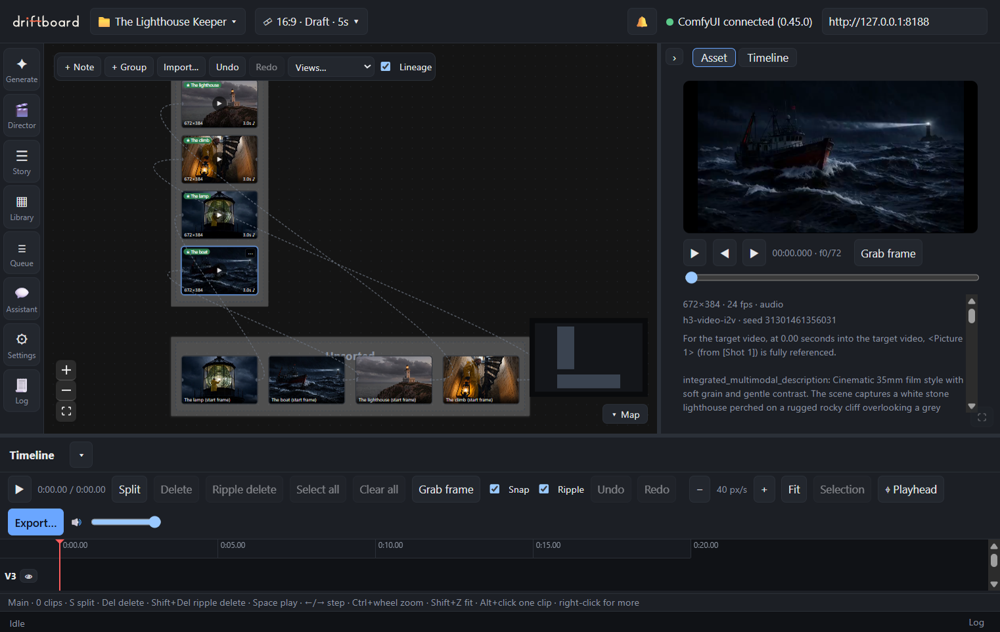
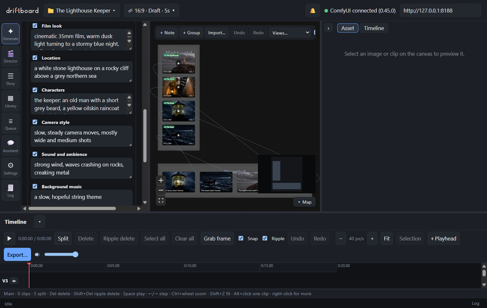
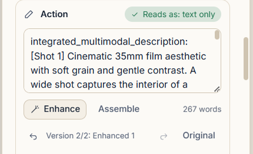
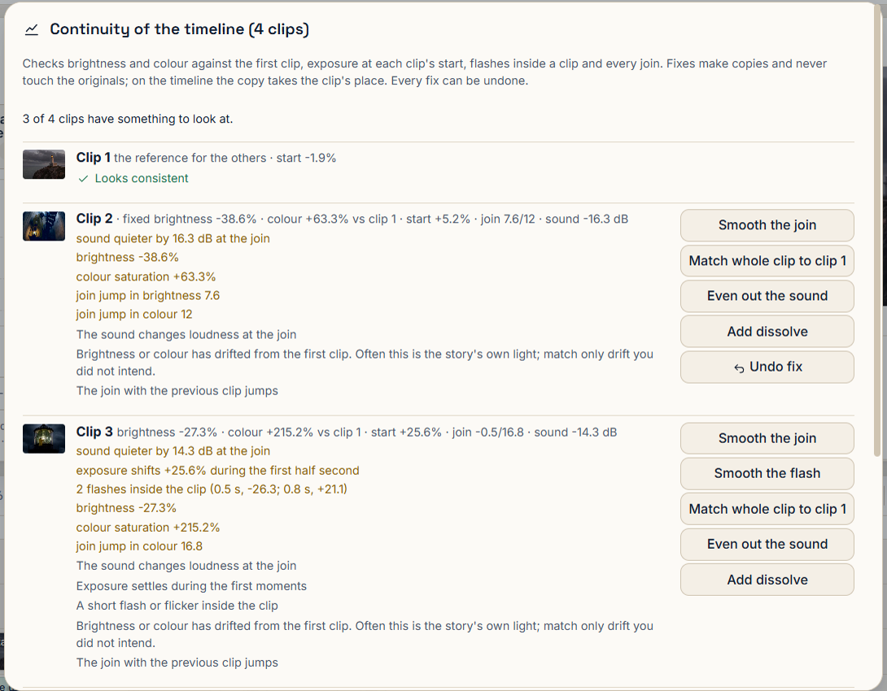
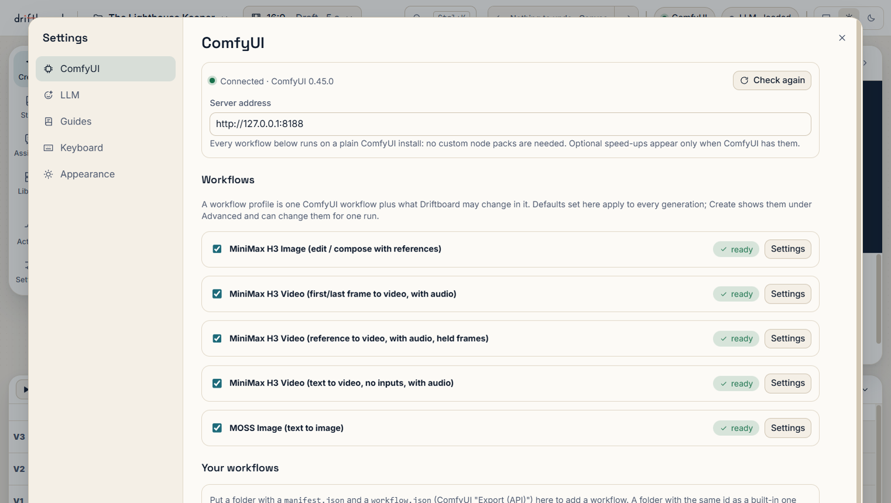

<div align="center">


<br />
<br />

<picture>
  <source media="(prefers-color-scheme: dark)" srcset=".github/readme/wordmark-light.svg" />
  
</picture>

### Make short AI films on your own computer

Canvas, story, timeline and export in one desktop app. Your own ComfyUI makes the pictures and clips,<br />your own local LLM writes the prompts. Nothing leaves your machine.

[](LICENSE)


</div>

<p align="center"></p>

<p align="center"><sub>Screenshots show the current early interface; a full redesign is on the way.</sub></p>

## Contents

- [What it is](#what-it-is)
- [What it offers](#what-it-offers)
- [What you need](#what-you-need)
- [Install](#install)
- [First start](#first-start)
- [How to use it](#how-to-use-it)
- [Making it your own](#making-it-your-own)
- [Privacy](#privacy)
- [Run and build from source](#run-and-build-from-source)
- [Troubleshooting](#troubleshooting)
- [Changelog](#changelog)
- [Credits](#credits)
- [License](#license)

## What it is

Driftboard is a free, open-source desktop app for making films of about one to five minutes with AI image and video models. It puts everything in one place: an infinite canvas where every picture and clip lands, a story with scenes, shots and takes, a timeline editor with a preview and export, and an LLM that turns short ideas into full prompts.

It does not generate anything itself and has no built-in models. It drives two programs you run yourself:

- **[ComfyUI](https://github.com/comfyanonymous/ComfyUI)** runs the image and video workflows.
- **A local LLM server** ([LM Studio](https://lmstudio.ai), [Ollama](https://ollama.com), or any OpenAI-compatible server) writes and checks prompts, reads pictures, and helps with the story.

Models are described by small **profiles** (a ComfyUI workflow plus a manifest), so the app itself has no model knowledge and new models can be added without changing the code.

## What it offers

**Generate**
- One form for every model, with an exact size chooser (aspect, resolution, megapixels, or your own width × height), batch runs with a new seed each, and variations.
- Text to video, first/last frame to video, reference to video (pictures, video and audio references), text to image and image editing, all with sound where the model makes it.
- **Film blocks:** decide the film look, location, characters, camera style, sound, background music and dialogue language once per story. Every prompt carries them, so you only write the action of each shot. Writing the story bible fills them from the script's tone (film look, camera style, sound, music, dialogue language); what you wrote yourself is never replaced.
- **Enhance:** the LLM writes the full prompt for the chosen model from your action, the film blocks and the previous clip, following an editable guide for that model. Every version is kept (what you wrote, each Enhance, your edits in between): step back and forth or go back to the original.

<p align="center"></p>
<p align="center"></p>

**Continuity between shots**
- **Continue** and **Bridge** from any clip: from its last frame, or with *held frames* (the end of one clip anchors the start of the next, so motion, light and place carry over; the held frames are added to the length you choose and trimmed off again on the timeline, so the new part is as long as you asked). The new shot keeps the earlier clip's film blocks and prompt, and the pictures it was made from (first frame, reference pictures) go along as references, so the characters, their clothing and the place stay the same.
- **Smooth joins:** where a clip continues another, its start meets the previous clip's last frame and fades back over two seconds, and the quick exposure flicker the model puts right after the held frames is evened out frame by frame; a bridge also arrives exactly at the next clip's start. Slower light changes in the story stay.
- **Check continuity** of clips or the whole timeline: brightness and colour drift, jumps at joins, flashes inside a clip, soft joins, sound level jumps, with one-click fixes (smooth the join, smooth a flash, add a dissolve, even out the sound). Every fix is a copy and can be undone.

<p align="center"></p>
- Prepare any input picture: see its real size, scale it up or down (a new copy; the original stays), or edit it with an image model first.

**Story workspace**
- Stories, scenes, shots and takes, with picks that go straight to the timeline.
- One Story workspace with four stages: **Script**, **Bible**, **Board** and **Shots**. The LLM turns a script (or any text) into a screenplay, a bible of characters, places and props with reference pictures, scenes, shots and prompts; or start from your own storyboard pictures. The plan reaches the story's shots by itself, and takes, picks and edited prompts stay.
- **Shots are planned like an editor would:** a new shot only where a film would cut; moments one camera move can follow share one clip with timed beats. A shot longer than the longest clip (10 s by default, so it stays affordable on a 12 GB card) is cut into parts that continue the same take: Run all makes each part from the last frames of the part before as soon as it has a take, and its prompt carries on from the previous one. Cuts start fresh but know how the previous shot ended (who is where, holding what).
- An Assistant chat that can see pictures you attach and proposes generations you can run with one click.

**Edit and export**
- Timeline with ripple editing, split, trim, speed, linked audio, a clip menu (regenerate, replace, continue, bridge into a gap), zoom and full-screen preview.
- Export with quality, resolution, frame rate and audio settings.
- Crop, trim, resize and upscale on the canvas; nothing is ever overwritten (every edit is a new copy).
- Library with names, tags, trash and bulk rename; a queue; projects with backups; undo everywhere.

## What you need

| | Tested with | Notes |
|---|---|---|
| **Windows** | Windows 11, 64-bit | Windows 10 64-bit should work. |
| **Graphics card** | NVIDIA RTX 4070, 12 GB | Video models need a lot of video memory; less than 12 GB is untested. |
| **ComfyUI** | 0.45.0 | A plain install is enough: the bundled workflows use only ComfyUI's own nodes. |
| **LLM server** | LM Studio with Gemma 4 12B | Ollama and other OpenAI-compatible servers also work. A model that can read pictures is recommended. |

**Model files** for the bundled profiles. Put them in ComfyUI's usual model folders; Settings → ComfyUI shows what is missing. You can switch any profile to other files (a fine-tune, for example).

| Profile | Main model (`diffusion_models`) | Text encoder (`text_encoders`) | VAE (`vae`) |
|---|---|---|---|
| H3 video: text, first/last frame | `minimax_h3_fl2va_pruned_int8_convrot` | `qwen3vl_32b_minimax_h3_nvfp4_awq` | `minimax_h3_video_vae_int8_convrot`, `minimax_h3_audio_vae_fp32` |
| H3 video: references, held frames | `minimax_h3_ref2va_pruned_int8_convrot` | `qwen3vl_32b_minimax_h3_nvfp4_awq` | `minimax_h3_video_vae_int8_convrot`, `minimax_h3_audio_vae_fp32` |
| H3 image edit | `minimax_h3_image_pruned_int8_convrot` | `qwen3vl_32b_minimax_h3_nvfp4_awq` | `minimax_h3_image_vae_fp16` |
| MOSS text to image | `moss_image_sft_int8_convrot_attn` | `MOSS_qwen3.5_9b_int8_convrot` | `flux2-vae` |

(All files end in `.safetensors`.) Optional: with [ComfyUI-KJNodes](https://github.com/kijai/ComfyUI-KJNodes) and the `sageattention` Python package installed, a SageAttention switch appears for the video profiles (faster).

## Install

1. Download `Driftboard-<version>-portable.exe` from the [Releases](../../releases) page.
2. Run it. There is no installer; the app keeps its settings in `%APPDATA%\Driftboard`.

The exe is not code-signed yet, so Windows SmartScreen may warn the first time: choose **More info → Run anyway**. ffmpeg is included.

## First start

1. Start **ComfyUI** (default address `http://127.0.0.1:8188`) and your **LLM server** (LM Studio: `http://127.0.0.1:1234/v1`, Ollama: `http://127.0.0.1:11434/v1`).
2. Start Driftboard and create a project in an empty folder (**📁 Projects → New project…**). A project is a normal folder: pictures, clips, exports and backups all live in it.
3. Open **⚙ Settings → ComfyUI**: every profile should say *ready*. If something is missing it names the node or model file.
4. Open **⚙ Settings → LLM and guides**: pick the server and the model. The app loads the model when it needs it and frees the graphics card before ComfyUI generates.

<p align="center"></p>

## How to use it

**Make a first clip**
1. Open **Story**, create a story and fill in its **Film blocks** in the Bible stage (film look, location, sound, music...). Empty blocks are simply not used.
2. Open **Create**, choose a model, write only the action (*"The keeper climbs the stairs with a lantern"*) and press **Enhance**. The LLM writes the full prompt with your blocks. **Assemble** puts them together without the LLM.
3. Choose the size and press **Generate**. The result lands on the canvas; failed jobs never do.

**Build a sequence**
- Right-click a clip on the canvas: **Continue with held frames** makes the next shot from the end of this one; **Bridge** fills the space between two clips. The film blocks and the previous prompt come along: write only what happens next.
- Make shots in Story › Shots, pick the best take of each, then **Picks → timeline**.
- On the timeline, right-click a clip or a gap for regenerate, replace, continue or bridge; **Check continuity of the whole timeline** finds jumps, flicker and flashes between shots and fixes them; each fix can be undone.

**From a script or storyboard**
- **Script**: paste a script or a short story. *Interpret* turns it into a screenplay you can check; then the Bible, the shots and the prompts are written step by step. The shots appear in the Shots stage as soon as they are planned.
- **Board**: drop your own pictures in order, let the LLM describe them and build the story, then write the prompts. Pictures can be chained so each one ends where the next begins.

**Export**: **Export…** on the timeline writes the film to the project's `exports` folder.

Everything can be undone (Ctrl+Z works on the area under the mouse pointer; the Undo button in the top bar names that area). **Ctrl+K** opens the command palette: any action, story, shot, file or settings page by name. Light and dark themes are in the top-right corner, and keyboard shortcuts can be changed in Settings.

## Making it your own

- **Guides** (*Settings → Guides*): every LLM task follows a plain text guide (one per model, plus the Director, Assistant and storyboard steps). Edit one and your version is used from then on; *Reset to built-in* brings the original back. Your edits stay in your user folder.
- **Profiles** (*Settings → ComfyUI*): choose the model files of each profile, set defaults (steps, CFG, speed-ups) for every generation, switch profiles off, or reset them to stock. To add a model, put a folder with a `manifest.json` and a ComfyUI `workflow.json` (*Export (API)*) into the user profiles folder (*Open folder* in the same tab); a folder with the same id replaces a built-in profile.
- **LLM servers**: LM Studio and Ollama are detected automatically and get full control (load with the right context size, unload to free the graphics card). Other OpenAI-compatible servers (llama.cpp server, KoboldCpp, Jan, text-generation-webui, vLLM...) work for chat; unload their model yourself before generating if memory is tight.

## Privacy

Driftboard talks only to the ComfyUI and LLM addresses you give it (by default on your own computer). There are no accounts, no telemetry, no update checks and no cloud services. Projects are plain folders you own.

## Run and build from source

Needs [Node.js](https://nodejs.org) 24 and Windows.

```bash
npm install
cd packages/app
npm start            # build and run
npm run dist         # portable exe in packages/app/release
```

Tests: `npm test` inside any package (`packages/core`, `profiles`, `adapter-comfy`, `adapter-llm`, `media`, `editor`, `director`, `app`).

| Folder | What it is |
|---|---|
| `packages/core` | projects, database, assets, jobs, story, film blocks |
| `packages/profiles` | profile manifests and how values go into a workflow |
| `packages/adapter-comfy` | ComfyUI client and job queue |
| `packages/adapter-llm` | LLM client (LM Studio, Ollama, OpenAI-compatible) and guides |
| `packages/media` | ffmpeg operations and continuity analysis |
| `packages/editor` | timeline editor (adapted from LTX-Desktop) |
| `packages/director` | script → bible → scenes → shots → prompts |
| `packages/app` | the Electron app |
| `profiles/`, `guides/` | the bundled profiles and LLM guides |

## Troubleshooting

- **A profile says "missing parts".** Settings → ComfyUI names the node or model file. Put the file in ComfyUI's model folder and press *Check again*, or pick another file in the profile's settings.
- **The image edit gives noise.** Use at least about 0.5 megapixels; smaller sizes are below what the model can do.
- **The LLM answers nothing or is very slow.** Turn thinking off for that task in Settings → LLM, or give the model more context there.
- **Out of graphics memory.** Keep *Unload before each ComfyUI job* on (Settings → LLM), and with servers that cannot unload (see above) close the model yourself.
- **Logs.** *Activity → Log* shows everything the app did; *Show file* opens the folder of the log file.

## Changelog

<details open>
<summary><b>0.1.0</b> (18 Nov 2026): first early version</summary>

- Canvas, Generate form with exact sizes, batches and variations; crop, trim, resize, upscale.
- Profiles for MiniMax H3 (text, first/last frame and reference to video with sound; image edit) and MOSS (text to image), running on a plain ComfyUI.
- Settings → ComfyUI: model choice per profile, defaults, profile on/off, your own profiles folder, health check.
- LLM: LM Studio, Ollama and other OpenAI-compatible servers; editable guides; Enhance; Assistant chat with pictures.
- Film blocks per story; Continue and Bridge (also with held frames) carry blocks and the previous prompt.
- Continuity check and fixes (seam match, dissolves, sound levels).
- Story (stories, scenes, shots, takes, picks), Director (script, bible, scenes, shots, prompts) and Storyboard.
- Timeline editor with ripple editing, regenerate/replace/bridge, preview and export.
- Library, queue, notifications, log, projects screen with backups, undo everywhere, editable shortcuts.

Sand Atelier redesign and fixes from testing:


- New look in light (default) and dark, local fonts, one line icon set.
- Top bar with project, film settings, an Undo that names the area it acts on, ComfyUI and LLM status; panels Create, Story, Assistant, Library and Activity (queue, messages, log) float over the canvas; Settings and Projects as sheets.
- Story and Director merged into one Story workspace (Script, Bible, Board, Shots) that keeps the story up to date by itself.
- Inspector next to the viewer, grouped timeline toolbar, Library with Trash and Rename in order, command palette (Ctrl+K).
- Create: optional inputs grouped in cards (Motion and sound references, Continue or bridge, Storyboard anchors) whose settings appear only once the input is filled; held frames no longer shorten the new part of a clip; Prepare can scale a picture down.
- Every LLM task can be cancelled and shows in the status bar; lineage wires run under the nodes (all, or only the selection's); one Fold all / Open all toggle and a back-to-top button in long panels.
- Joins: per-frame smoothing after held frames (no more flicker after a continue or bridge); a bridge's held frames at the end are trimmed too (it no longer repeats the start of the next clip) and are added to its length, so it still fills the gap.
- Continuity check: finds flashes inside a clip, Smooth the flash, Remake for clips made by the older join fix, Undo fix per clip and Undo all; fixes from the timeline no longer put copies on the canvas; "Match whole clip to clip 1" only for real drift, against clip 1's settled look.
- Enhance keeps every version of the prompt (Back, Forward, Original); right-click in a text box offers spelling suggestions; Show on canvas in Activity jumps to the result.
- One style setting: the bible's style is the story's Film look block (writing the bible fills it, editing it updates the reference-picture style); shot prompts no longer get the style twice. Film blocks sit at the top of the Bible.
- Shot planning in clips of timed beats; long shots cut into parts of at most the longest clip (default 10 s) that Run all chains through held frames; each shot's end state carries to the next shot of the scene; the bible also fills camera, sound, music and language blocks.
- Story stages say when you do not need them: the Board points to Shots for a story started from a script, Script and Bible explain themselves for a story started from pictures. The "Looks right" checkbox is gone.
- Storyboard anchors explain what they do in the Create form; the status dot of a shot without takes is round again.
</details>


## Credits

Driftboard builds on the work of many others:

- **[LTX-Desktop](https://github.com/Lightricks/LTX-Desktop)** by Lightricks: the timeline editor core (Apache-2.0, see `packages/editor/NOTICE.md`).
- **[ComfyUI](https://github.com/comfyanonymous/ComfyUI)**, which runs every workflow, and the **MiniMax H3** and **MOSS** model teams.
- **[LM Studio](https://lmstudio.ai)** and **[Ollama](https://ollama.com)** for local LLMs.
- **[FFmpeg](https://ffmpeg.org)** (GPL build by [gyan.dev](https://www.gyan.dev/ffmpeg/builds/), via [ffmpeg-static](https://github.com/eugeneware/ffmpeg-static)).
- **[Electron](https://www.electronjs.org)**, **[React](https://react.dev)**, **[React Flow](https://reactflow.dev)**, **[Vite](https://vite.dev)**, **[esbuild](https://esbuild.github.io)**, **[Zod](https://zod.dev)**, **[Zustand](https://github.com/pmndrs/zustand)**, **[Lucide](https://lucide.dev)**.
- Ideas re-implemented from **IV Studio** and **OpenField** (MIT) for robust LLM answers.

Every adapted file and bundled binary is listed in [THIRD_PARTY.md](THIRD_PARTY.md).

## License

Driftboard is free software under the [GNU General Public License v3.0](LICENSE). The Driftboard name, logo and icon are not covered by that license; see [BRAND.md](BRAND.md).
